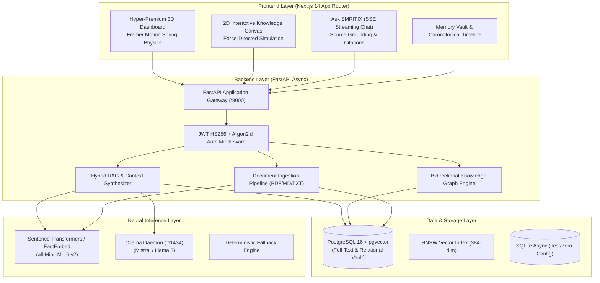

# SMRITIX: The Sovereign Personal AI Memory System

> **Remember. Interconnect. Resurface.**  
> *A local-first, privacy-sovereign second brain powered by hybrid search, knowledge graphs, and on-device neural RAG.*

---

## 🌟 Executive Overview

**SMRITIX** is a full-stack personal AI memory application designed to capture, organize, interconnect, and synthesize your digital knowledge. Unlike cloud-tethered note systems, SMRITIX runs **100% locally on your hardware** with zero telemetry, zero mandatory cloud egress, and zero recurring token costs.

Whether you're capturing rapid thoughts, ingesting technical research PDFs, searching through past projects, or querying your knowledge base via natural language, SMRITIX structures and surfaces your thoughts effortlessly.

---

## 🏛️ System Architecture



---

## ⚡ Core Capabilities Across All 7 Phases

### 1. Phase 1: Authentication & Foundational Storage
- **Multi-Tenant User Isolation**: Secure authentication with Argon2id password hashing and JWT access tokens.
- **RESTful Memory CRUD**: Create, read, update, delete, archive, and restore memory entries.
- **Tag Management System**: Semantic labeling with custom hex colors and tag filtering.

### 2. Phase 2: Ingestion & Vector Pipeline
- **Document Extractors**: High-performance extraction for Markdown, plain text, and PDF files.
- **Semantic Sentence Chunking**: Overlapping chunking strategy (500 tokens / 50 token stride) with sentence-boundary preservation.
- **Vector Embeddings**: 384-dimensional dense vectors generated via on-device embedding models with cosine similarity indexing.

### 3. Phase 3: Hybrid Search (RRF)
- **Reciprocal Rank Fusion**: Simultaneously runs PostgreSQL `tsvector` full-text BM25 ranking and dense HNSW vector similarity search.
- **RRF Equation**: $RRF\_Score = \frac{1}{60 + rank_{BM25}} + \frac{1}{60 + rank_{vector}}$.
- **Search History & Filters**: Query history tracking, type filtering, and minimum score thresholds.

### 4. Phase 4: Ask SMRITIX (Conversational RAG)
- **Streaming Natural Language Responses**: Server-Sent Events (`POST /api/v1/ask/stream`) streaming response tokens in real-time.
- **Citation & Source Attribution**: Explicit citation indices (`[1]`, `[2]`) linking generated answers directly back to source memories.
- **Persistent Conversation History**: Multi-turn dialogue support with automatic topic titling.

### 5. Phase 5: Dynamic Knowledge Graph
- **2D Interactive Physics Simulation**: Canvas-rendered force-directed network graph with pan, zoom, and node dragging.
- **Auto-Connection Discovery**: Automatically identifies and connects semantically related memories when cosine similarity exceeds $0.65$.
- **Manual Edge Relationships**: Connect memories with relationships (`related_to`, `references`, `similar_to`, `part_of`).
- **Topic Clustering**: Community detection grouping memories into navigable clusters.

### 6. Phase 6: Hyper-Premium 3D Dashboard & Polish
- **Interactive 3D Spring-Physics Tilt Cards**: Dynamic mouse cursor tracking with Framer Motion spring physics and specular surface lighting.
- **Telemetry-Free Knowledge Health Gauge**: Dynamic circular SVG metric detecting untagged or orphaned memories.
- **Chronological Memory Timeline**: Visual tree timeline grouping knowledge chronologically by day.
- **System & Neural Control Center**: Live Ollama daemon status pings, embedding model parameters, and privacy boundary enforcement.

### 7. Phase 7: Testing, Hardening & Verification
- **100% Passing Test Suite**: 24 comprehensive backend test cases covering multi-tenant security isolation, Unicode handling, and RAG edge cases.
- **Client-Side Unit Tests**: Utility and state verification passing with native Node.js test runner.
- **Unified Error Envelopes**: Structured error responses (`error.code`, `error.message`, `meta.request_id`) with global exception handling.
- **Deep Health Diagnostics**: `/api/v1/health` verifying database connectivity and runtime flags.

---

## 🚀 Quick Start Guide

### Prerequisites
- **Python 3.12+**
- **Node.js 20+**
- *(Optional)* [Docker Desktop](https://www.docker.com/) for PostgreSQL & Qdrant
- *(Optional)* [Ollama](https://ollama.com/) for local LLM inference (`ollama pull mistral`)

### 1. Automated Start (Windows One-Click)
Run the startup script in your terminal:
```cmd
start-all.bat
```
This automatically launches the FastAPI backend on `http://localhost:8000` and the Next.js frontend on `http://localhost:3000`.

### 2. Manual Startup

#### Terminal 1 — Backend
```bash
# Activate virtual environment
backend\.venv\Scripts\activate   # Windows
# source backend/.venv/bin/activate  # macOS / Linux

# Start FastAPI server
uvicorn app.main:app --reload --host 0.0.0.0 --port 8000
```

#### Terminal 2 — Frontend
```bash
cd frontend
npm run dev
```

Open your browser at **`http://localhost:3000`**.

---

## 🧪 Running the Test Suite

Execute the unified test runner:
```cmd
run-tests.bat
```

Or run backend and frontend tests independently:

```bash
# Backend Pytest Suite (24 tests)
backend\.venv\Scripts\python.exe -m pytest -v

# Frontend Unit Tests
cd frontend && npm test

# Frontend TypeScript Type Check
cd frontend && npm run type-check

# Frontend Linting Check
cd frontend && npm run lint

# Next.js Production Build
cd frontend && npm run build
```

---

## 📡 REST API Reference

| Method | Endpoint | Description | Auth Required |
|---|---|---|---|
| `GET` | `/api/v1/health` | Deep system health & database ping | No |
| `POST` | `/api/v1/auth/register` | Register new user account | No |
| `POST` | `/api/v1/auth/login` | Login and receive JWT access token | No |
| `GET` | `/api/v1/auth/me` | Fetch authenticated user profile | Yes |
| `GET` | `/api/v1/memories/` | List memories with pagination and filters | Yes |
| `POST` | `/api/v1/memories/` | Create a new memory with automatic chunking | Yes |
| `GET` | `/api/v1/memories/{id}` | Retrieve memory detail with chunks and sources | Yes |
| `PATCH` | `/api/v1/memories/{id}` | Update title, content, or tags | Yes |
| `DELETE` | `/api/v1/memories/{id}` | Delete memory and cascade vectors | Yes |
| `POST` | `/api/v1/memories/{id}/archive` | Archive memory | Yes |
| `POST` | `/api/v1/memories/{id}/restore` | Restore archived memory | Yes |
| `POST` | `/api/v1/search/` | Hybrid Reciprocal Rank Fusion search | Yes |
| `GET` | `/api/v1/search/history` | Retrieve past search queries | Yes |
| `POST` | `/api/v1/ask/` | RAG query synthesis with sources | Yes |
| `POST` | `/api/v1/ask/stream` | Server-Sent Events (SSE) streaming RAG | Yes |
| `GET` | `/api/v1/ask/conversations` | List conversation threads | Yes |
| `GET` | `/api/v1/graph/` | Full knowledge graph nodes and edges | Yes |
| `POST` | `/api/v1/graph/edges` | Create manual knowledge relationship | Yes |
| `DELETE` | `/api/v1/graph/edges/{id}` | Remove knowledge edge | Yes |
| `GET` | `/api/v1/dashboard/stats` | Aggregated metrics & 7-day sparkline | Yes |
| `GET` | `/api/v1/dashboard/timeline` | Chronological memory grouping | Yes |
| `GET` | `/api/v1/dashboard/knowledge-gaps`| Knowledge base health score & gaps | Yes |
| `GET` | `/api/v1/settings/ai` | Neural engine and Ollama connection status | Yes |
| `GET` | `/api/v1/settings/privacy` | Privacy flags and sovereignty parameters | Yes |

---

## 🔒 Privacy & Sovereignty Manifesto

- **Zero Cloud Egress**: Your data never leaves your device unless you explicitly configure an external LLM endpoint.
- **Zero Analytics / Telemetry**: No third-party trackers, beacons, or user behavior profiling.
- **Encrypted Storage**: Cryptographically secure Argon2id password hashing and JWT HS256 authentication.
- **Export Sovereign**: Open data schemas allowing full relational and vector exports at any time.

---

## 📄 License
Private & Sovereign — All rights reserved.
